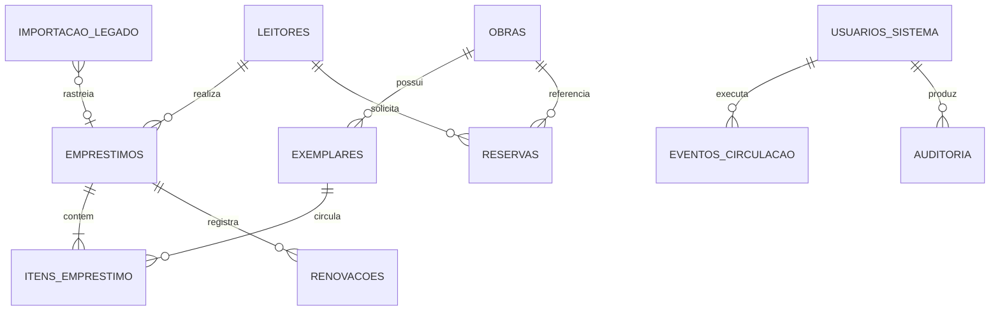

# Arquitetura e primeira entrega

## Decisão de tecnologia

React 19 + TypeScript, Vite, CSS responsivo e ícones Lucide. Fontes Inter hospedadas junto com a aplicação. ESLint, TypeScript e Playwright verificam a interface; GitHub Actions repete as verificações em Pull Requests. A arquitetura desta entrega é uma aplicação estática, sem serviços externos em tempo de execução.

A navegação usa fragmentos de URL (`#emprestimos`, `#livros` etc.), permitindo links diretos e histórico do navegador sem configuração de rotas no servidor de hospedagem. O conteúdo dos módulos é demonstrativo e somente consultável. Menus móveis e detalhes usam o elemento nativo `dialog`, com foco e fechamento por Escape.

## Dados demonstrativos

`src/data/demo.ts` concentra tipos, cenário determinístico e cálculos. São 12 obras fictícias, 1.248 exemplares, 286 leitores fictícios, 334 empréstimos (48 em aberto, incluindo 7 em atraso), 286 devoluções, 8 renovações e 6 reservas ilustrativas. A data fixa é 13/10/2026, evitando mudanças nos resultados durante a revisão.

Os totais, as consultas e os gráficos usam o mesmo cenário. A disponibilidade demonstrativa é calculada a partir dos itens não devolvidos; não valida a situação física da biblioteca nem impõe bloqueio por reservas. Datas e situações das reservas são somente exemplos. O catálogo distingue obra de exemplar; empréstimos contêm uma lista de itens, mesmo quando o cenário exibe apenas um item por empréstimo.

O protótipo não escreve em banco, `localStorage` ou serviços remotos. A exportação produz somente um resumo agregado fictício. Dados sensíveis e arquivos da planilha não fazem parte da entrega.

## Telas e fluxos

| Tela        | Comportamento nesta entrega                                               | Evolução a validar                                                                         |
| ----------- | ------------------------------------------------------------------------- | ------------------------------------------------------------------------------------------ |
| Dashboard   | Indicadores, atalhos, gráfico de período, acervo e amostra de empréstimos | Indicadores transacionais e filtros operacionais                                           |
| Empréstimos | Busca, filtro por situação/vencimento, paginação e detalhes               | Selecionar leitor, exemplares e prazo; confirmar retirada no servidor                      |
| Devoluções  | Consulta dos retornos fictícios                                           | Selecionar empréstimo e itens, registrar retorno total/parcial e atualizar disponibilidade |
| Renovações  | Consulta com prazo anterior e novo prazo                                  | Validar regras, selecionar escopo e registrar novo evento sem apagar prazos                |
| Reservas    | Lista e detalhes ilustrativos                                             | Política de fila, validade, retirada e cancelamento                                        |
| Livros      | Catálogo, autor, categoria e contagens por obra                           | Cadastro progressivo de obras e exemplares físicos                                         |
| Leitores    | Busca e consulta sem campos sensíveis                                     | Cadastro com dados mínimos, permissões e retenção                                          |
| Histórico   | Eventos sintéticos de circulação                                          | Auditoria persistente com operador e alterações                                            |
| Relatórios  | Gráfico, acervo por categoria e exportação agregada fictícia              | Relatórios autorizados e conciliação com banco                                             |

Não há formulários de gravação nem autenticação simulada que pareça operacional. O perfil indica explicitamente seu caráter demonstrativo.

## Modelo futuro e relações

É uma proposta lógica. Confirmar reserva por obra ou exemplar, renovação por empréstimo ou item e a identificação de registros legados. Quando houver backend, validar disponibilidade e permissões no servidor, usar transações e garantir exclusividade de circulação por exemplar. Não tratar checagens React como controle de segurança.

## Próximas entregas pequenas

1. Revisar esta interface com a equipe e confirmar o primeiro fluxo e seus campos.
2. Prototipar o fluxo escolhido com dados fictícios e testes de comportamento, incluindo múltiplos itens e devolução parcial quando aplicável.
3. Definir backend relacional e autenticação após aprovação institucional, com perfis, autorização no servidor e auditoria.
4. Implementar cadastros e circulação em incrementos, testando duplicação de exemplar, vencimentos e preservação do histórico.
5. Planejar backups, restauração e migração rastreável antes de usar dados reais.

## Privacidade e segurança

Esta entrega usa dados mínimos inventados, não coleta contatos/documentos e não possui analytics nem chamadas a terceiros. O `.gitignore` exclui credenciais, planilhas, extratos, bancos e backups. O workflow de CI tem somente permissão de leitura do repositório e não faz implantação.

Nas próximas fases: HTTPS; autenticação com contas individuais; autorização por perfil no servidor; minimização e retenção aprovadas; gestão de segredos; auditoria de ações; exportações restritas; backups protegidos e restauração testada; migração em ambiente institucional aprovado. Esses controles não estão implementados no protótipo.
